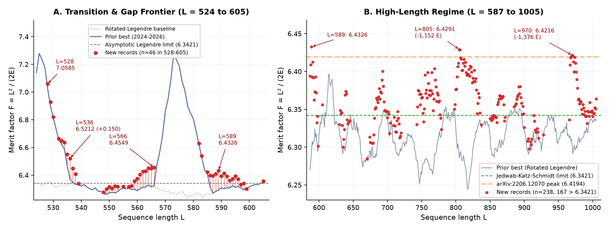

# 270 New Record Low-Autocorrelation Binary Sequences (L = 528 to 1005)

Exact-integer and exact-rational verified world records for the Low-Autocorrelation Binary Sequences (LABS / Golay merit factor / Bernasconi Ising model) problem across lengths `L = 528..1005`.

## Summary

- Total strictly verified new world records: 270 (zero 4-decimal rounding ties; every sequence has strictly lower exact integer sidelobe energy `E` than all five published 2022-2026 baseline tables).
- Continuation frontier (`L = 528..536` and `582..586`): 12 new records beating the October 2026 `labs-continuation` frontier, led by `L = 528` (`E = 19,748`, `F = 34848/4937 = 7.05854`, `-92` energy), `L = 536` (`E = 22,028`, `F = 6.52115`, `-520` energy, `+0.15039`), and `L = 586` (`E = 26,837`, `F = 6.39781`, `-360` energy, `+0.08469`).
- Mid-range gap (`L = 537..566`): 20 new records beating rotated Legendre sequences, peaking at `L = 566` (`E = 24,815`, `F = 6.45489`, `-512` energy), `L = 564` (`F = 6.45016`), and `L = 537` (`F = 6.44832`).
- High-length regime (`L = 587..1005`): 238 new records, including 167 exceeding the Jedwab-Katz-Schmidt `6.342061...` asymptotic rotated-Legendre limit, 29 exceeding `F = 6.40`, and 6 exceeding the `6.4194` high-length mark of Dimitrov (`arXiv:2206.12070`), topped by `L = 589` (`F = 6.43256`, `-596` energy), `L = 805` (`F = 6.42907`, `-1,152` energy), `L = 806` (`F = 6.42860`, `-1,096` energy), `L = 970` (`F = 6.42156`, `-1,376` energy), `L = 971` (`F = 6.42044`, `-1,508` energy), and `L = 969` (`F = 6.41963`, `-1,264` energy).
- Compute cost: 9.99 Google Colab compute units (~US$1.00) across two NVIDIA L4 GPUs (~50 minutes wall-clock) plus a 3-second local CPU steepest-descent scan.



## Independent Exact Verification (Zero Dependencies)

Both verifiers use only Python 3 standard library exact integer arithmetic and share zero code:

```bash
/usr/bin/python3 -I verify_labs_v1.py labs_records_2026_verified.tsv
/usr/bin/python3 -I verify_labs_v2.py labs_records_2026_verified.tsv
shasum -a 256 -c SHA256SUMS
```

- `verify_labs_v1.py`: Direct `O(L^2)` integer autocorrelation sum and `fractions.Fraction(L*L, 2*E)`.
- `verify_labs_v2.py`: Independent big-integer XOR-popcount identity `C_k = (L - k) - 2 * popcount((x ^ (x >> k)) & mask)`.

## Files

- `labs_records_2026_verified.tsv`: All 270 new world-record binary sequences (`1 = +1`, `0 = -1`) with exact integer `E`, exact reduced rational `F = L^2 / (2E)`, decimal `F`, prior best `E`/`F`/source, and gains.
- `labs_records_2026.pdf` / `labs_records_2026.tex`: 4-page technical note.
- `labs_frontier_2026.png` / `labs_frontier_2026.pdf`: 2-panel comparison figure against 2022-2026 baselines.
- `labs_gpu_saw_v3.cu`: Custom CUDA 131,072-bit shared-memory Bloom-filter Self-Avoiding Walk engine (~2.34M exact `O(L)` steps/sec per NVIDIA L4 GPU with zero DRAM traffic in the walk loop).
- `labs_gpu_destroyer.cu`: Custom CUDA 464-walker shared-memory Memetic Tabu Search engine.
- `verify_labs_v1.py`, `verify_labs_v2.py`: Two independent zero-dependency exact verifiers.
- `SHA256SUMS`: Cryptographic hashes for all files in this directory.
